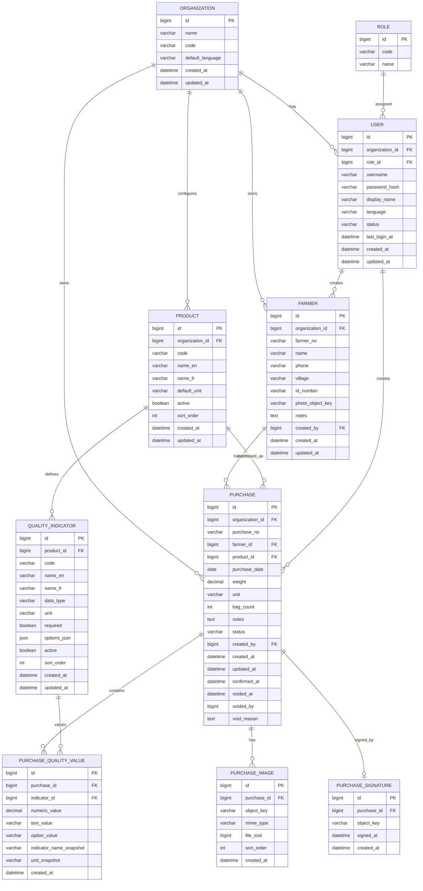

# 农产品收购管理 App V1.0
## 页面级 PRD + Android 页面原型结构 + 后端数据库 ER 设计

---

# 一、V1.0 产品范围确认

## 1.1 产品目标

V1.0 只验证一个核心业务闭环：

**老板识别农民 → 记录本次农产品收购 → 拍摄实物照片 → 填写重量和质量指标 → 农民签字确认 → 生成收购概要 → 后续可查询。**

第一版不建设 ERP。

暂不开发：

- 员工管理
- 工单
- 库存
- 仓库
- 财务
- 预付款
- 报关
- 出口
- 物流
- 客户销售
- 农民 App
- iOS
- 完整离线同步

---

## 1.2 V1.0 用户

### Owner / 老板

唯一需要登录的业务角色。

拥有：

- 农民管理权限
- 收购记录创建权限
- 收购记录查看权限
- 收购记录作废权限
- 基础数据配置权限
- 数据导出权限

### Farmer / 农民

农民不登录系统。

农民在系统中只是业务对象，参与：

- 建档
- 收购
- 签字确认

---

## 1.3 产品形态

### Android App

负责现场业务。

### Web Admin

负责后台查询、配置和管理。

### Backend API

同时服务 Android 和 Web。

### 阿里云

数据库：

**RDS MySQL**

图片与签名：

**OSS**

后端：

**ECS**

---

# 第一部分：页面级 PRD

# 二、Android 页面级 PRD

Android 页面编号统一使用：

**Axx**

---

# A01 登录页

## 页面目标

完成老板身份认证，并进入系统。

## 页面内容

### Logo / 产品名称

顶部显示产品 Logo 和产品名称。

### Username

用户名输入框。

### Password

密码输入框。

支持密码显示 / 隐藏。

### Login

主按钮：

**Login**

法语：

**Connexion**

### Language

页面右上角提供：

**English / Français**

切换后当前页面立即更新语言。

---

## 页面交互

点击 Login：

1. 校验用户名和密码是否为空；
2. 调用登录 API；
3. 登录成功保存 Token；
4. 跳转首页；
5. 后续启动 App 时，Token 有效则直接进入首页。

---

## 异常状态

### 用户名为空

提示：

Please enter username.

### 密码为空

提示：

Please enter password.

### 登录失败

提示：

Incorrect username or password.

### 网络异常

提示：

Unable to connect. Please check your network.

---

# A02 首页

## 页面目标

让老板最快进入核心收购流程。

页面应极简。

---

## 页面结构

顶部：

- 产品名称
- 当前用户
- 设置入口

主体最突出位置：

### + New Purchase

这是首页最大的按钮。

下方两个入口：

### Farmers

农民。

### Purchase Records

收购记录。

---

## 首页暂不显示

V1.0 不开发：

- 收购趋势
- 今日金额
- 库存
- 图表
- 财务 Dashboard

避免首页信息过载。

---

# A03 农民列表

## 页面目标

查询已经建立档案的农民。

---

## 页面内容

顶部：

### Search Farmer

支持：

- 姓名
- 手机号码
- Farmer ID

右上：

### + Add Farmer

---

## 农民列表 Item

每条显示：

**Farmer Name**

Farmer ID

Phone

Village / Area

Last Purchase Date

---

## 空状态

没有农民时显示：

No farmers yet.

并提供：

**Add Farmer**

---

## 点击农民

进入：

**A05 Farmer Detail**

---

# A04 新建 / 编辑农民

## 页面目标

快速建立最基础的农民档案。

---

## 字段

### Farmer Name *

必填。

### Village / Area *

必填。

### Phone Number

选填。

### ID Number

选填。

### Farmer Photo

选填。

支持：

- Camera
- Remove
- Retake

### Notes

选填。

---

## 系统自动生成

### Farmer ID

例如：

F000001

F000002

前端无需用户填写。

---

## 操作

### Save

保存。

### Cancel

取消。

---

## 新建农民成功后的两种来源

### 从农民列表进入

保存后进入：

Farmer Detail。

### 从 New Purchase 进入

保存后：

自动返回 New Purchase 页面，并自动选中刚刚创建的农民。

这一点非常重要，避免现场重复操作。

---

## 数据校验

Farmer Name 为空：

禁止保存。

Village / Area 为空：

禁止保存。

---

# A05 农民详情

## 页面目标

查看农民档案和历史交易。

---

## 顶部

农民照片。

Farmer Name。

Farmer ID。

---

## 基础信息

Phone

Village / Area

ID Number

Notes

---

## 操作

### Edit Farmer

允许修改农民基础资料。

### New Purchase

直接以当前农民创建新的收购单。

---

## Purchase History

展示：

Date

Product

Weight

Purchase No.

点击进入：

**A11 Purchase Detail**

---

# A06 新建收购

这是整个 App 最核心的页面。

## 页面设计原则

第一版不把录入过程拆成很多页面。

采用：

**一个可滚动表单 + 最终 Review**

降低现场操作时间。

---

## Section 1：Farmer

显示：

### Select Farmer *

点击后打开农民选择页 / 弹层。

支持搜索：

- 姓名
- 手机号
- Farmer ID

如果不存在：

### + Add Farmer

完成农民创建后自动返回。

---

## Section 2：Product

### Product *

第一版后台默认：

- Cocoa
- Coffee

前端从 API 获取，不在代码中写死。

---

## Section 3：Basic Information

### Purchase Date *

默认今天。

允许修改。

### Weight *

数字输入。

例如：

120.5

### Unit *

默认：

kg

第一版可以默认选中 kg。

### Number of Bags

选填。

整数。

---

# Section 4：Quality Indicators

这里根据 Product 动态变化。

例如选择：

### Cocoa

服务器返回：

Moisture

Fermentation

Impurities

Quality Grade

App 根据指标类型自动生成对应输入组件。

---

## NUMBER 类型

例如：

Moisture

输入：

7.5

单位：

%

---

## SELECT 类型

例如：

Quality Grade

选择：

A

B

C

---

## TEXT 类型

自由输入。

---

## 原则

Android App 不包含：

```text
if product == cocoa:
    show moisture
    show fermentation
```

所有指标全部由服务器配置。

这样以后新增：

Cashew

Sesame

Rubber

不需要重新修改 Android 页面逻辑。

---

# Section 5：Photos

### Product Photos *

至少一张。

按钮：

**Take Photo**

支持继续增加照片。

例如：

Photo 1

Photo 2

Photo 3

---

## 图片操作

支持：

- Preview
- Retake
- Delete

---

## V1 上传逻辑

拍摄后：

先保存在 Android 本地缓存。

提交收购单时上传 OSS。

如果图片上传失败：

保留本地文件，并允许 Retry。

---

# Section 6：Notes

### Notes

选填。

多行文本。

---

# 页面底部

主按钮：

### Review

只有必须字段填写完成才允许进入下一步。

---

# A07 收购确认页

## 页面目标

在农民签字前，由老板和农民共同核对信息。

---

## 页面标题

Purchase Summary

---

## 页面显示

### Farmer

Farmer Name

Farmer ID

### Product

例如：

Cocoa

### Date

September 6, 2026

### Weight

120.5 kg

### Bags

5 bags

如果为空不显示。

### Quality

例如：

Moisture: 7.5%

Fermentation: Good

Grade: A

### Product Photos

缩略图。

### Notes

如果有则显示。

---

## 页面底部

### Back to Edit

返回修改。

### Confirm & Sign

进入农民签字。

---

## 关键规则

进入签字之前：

Purchase 状态：

**DRAFT**

仍然允许修改。

---

# A08 农民签字页

## 页面目标

获取农民对本次收购信息的确认。

---

## 顶部文字

英文：

I confirm that the information above is correct.

法语显示对应翻译。

---

## 签字区域

使用较大的白色 Canvas。

建议页面进入签字状态后支持横屏。

---

## 操作

### Clear

清除签名。

### Cancel

取消。

### Confirm Signature

确认。

---

## Confirm Signature 后

执行：

1. 将签字 Canvas 生成 PNG；
2. 上传 OSS；
3. 保存签字信息；
4. 调用 Confirm Purchase API；
5. Purchase 状态由 DRAFT → CONFIRMED；
6. 记录 confirmed_at；
7. 进入收购凭证页。

---

## 重要规则

一旦 Purchase 状态变成：

**CONFIRMED**

核心业务数据锁定。

Android 不再提供 Edit。

---

# A09 收购凭证页

## 页面目标

生成一个农民可以直接用自己手机拍照保存的页面。

---

## 页面标题

# PURCHASE RECEIPT

---

## 显示

Company / Buyer Name

Purchase No.

Farmer Name

Farmer ID

Product

Date

Weight

Quality Indicators

Notes

Farmer Signature

---

## 页面设计原则

该页面应该：

- 背景简单
- 字体较大
- 信息紧凑
- 一屏尽量展示主要信息
- Purchase No. 明显突出

方便农民：

**直接拍摄老板手机屏幕。**

---

## 页面按钮

### Done

返回首页。

### View Details

进入 Purchase Detail。

V1 暂不提供：

- PDF
- WhatsApp
- SMS

---

# A10 收购记录列表

## 页面目标

查看所有历史收购。

---

## 默认排序

最新记录在最上方。

---

## 每条记录显示

Date

Farmer Name

Product

Weight

Purchase No.

Status

---

## Status

### Confirmed

正常交易。

### Voided

已作废。

草稿原则上只展示老板尚未完成的记录。

---

## 搜索

支持：

Farmer Name

Purchase No.

---

## 筛选

### Date

日期范围。

### Product

产品。

### Status

Confirmed / Voided。

---

## 点击记录

进入：

**A11 Purchase Detail**

---

# A11 收购详情

## 页面目标

完整查看某一笔历史交易。

---

## 页面展示

Purchase No.

Status

Farmer

Product

Date

Weight

Unit

Bags

Quality Indicators

Product Photos

Notes

Signature

Created At

Confirmed At

---

## CONFIRMED 状态

只读。

页面底部：

### Void Purchase

---

## 作废确认

点击：

Void Purchase

弹窗：

Are you sure you want to void this purchase?

要求填写：

### Reason *

确认后：

Purchase：

CONFIRMED → VOIDED

保存：

void_reason

voided_at

voided_by

---

## 重要原则

历史 Purchase 不物理删除。

---

# A12 设置页

## 功能

### Language

English

Français

### Account

当前用户名。

### Logout

退出登录。

V1 暂不增加其他设置。

---

# 三、Web Admin 页面级 PRD

Web 页面编号：

**Wxx**

---

# W01 登录

字段：

Username

Password

Login

功能与 Android 登录一致。

---

# W02 农民管理

列表展示：

Farmer ID

Name

Phone

Village / Area

Created At

Last Purchase Date

---

## 支持

搜索。

查看。

修改。

---

# W03 农民详情

展示：

基础档案。

历史 Purchase。

点击 Purchase 进入详情。

---

# W04 收购记录

列表字段：

Purchase No.

Date

Farmer

Product

Weight

Status

Created At

---

## 支持筛选

Date Range

Farmer

Product

Status

---

## 支持导出

CSV

第一版推荐优先 CSV。

Excel 可以 V1.1 增加。

---

# W05 收购详情

展示与 Android Purchase Detail 基本相同。

后台拥有：

### Void Purchase

权限。

已确认记录：

不允许直接修改。

---

# W06 产品配置

列表：

Product Code

English Name

French Name

Active

---

## V1 默认

COCOA

Cocoa

Cacao

---

COFFEE

Coffee

Café

---

## 支持

Add

Edit

Enable / Disable

产品停用后：

历史记录仍然正常显示。

新建 Purchase 时不再显示。

---

# W07 质量指标配置

## 字段

Product

Indicator Code

English Name

French Name

Type

Unit

Required

Options

Sort Order

Active

---

## Type

NUMBER

TEXT

SELECT

---

## 示例

Product：

COCOA

Code：

MOISTURE

English：

Moisture

French：

Humidité

Type：

NUMBER

Unit：

%

Required：

Yes

---

# W08 用户管理

V1 默认只有老板。

字段：

Username

Name

Role

Status

---

## Role

OWNER

数据库层保留 Role。

V1 Web 暂不开发复杂权限配置页面。

---

# 第二部分：Android 页面原型结构

# 四、整体导航结构

建议 V1 使用：

**顶部 App Bar + 底部三 Tab + 首页主按钮**

底部导航：

```text
Home
Farmers
Records
```

Settings 从右上角进入。

---

# 五、Android 页面跳转图

```text
                        ┌──────────────┐
                        │   A01 Login  │
                        └──────┬───────┘
                               │
                               ▼
                    ┌────────────────────┐
                    │      A02 Home      │
                    └─────┬──────┬──────┘
                          │      │
              ┌───────────┘      └────────────┐
              ▼                               ▼
       A03 Farmer List                A10 Purchase Records
              │                               │
       ┌──────┴───────┐                       ▼
       ▼              ▼                 A11 Purchase Detail
A04 Add Farmer   A05 Farmer Detail
                      │
                      │ New Purchase
                      ▼
                 A06 New Purchase
                      │
                      ▼
                A07 Review Purchase
                      │
                      ▼
                 A08 Signature
                      │
                      ▼
                 A09 Receipt
                      │
                      ▼
                    A02 Home
```

同时：

A02 Home

可以直接进入：

A06 New Purchase。

---

# 六、关键页面低保真原型

## 6.1 Home

```text
┌───────────────────────────────┐
│ Agro Purchase             ⚙   │
│ Hello, Owner                  │
│                               │
│ ┌───────────────────────────┐ │
│ │                           │ │
│ │      + NEW PURCHASE       │ │
│ │                           │ │
│ └───────────────────────────┘ │
│                               │
│ ┌────────────┐ ┌────────────┐ │
│ │  Farmers   │ │  Records   │ │
│ │    128     │ │    526     │ │
│ └────────────┘ └────────────┘ │
│                               │
│                               │
├───────────────────────────────┤
│  Home      Farmers    Records │
└───────────────────────────────┘
```

数字统计可以先不做。

如果希望 V1 更轻：

只显示功能入口。

---

# 6.2 Farmer List

```text
┌───────────────────────────────┐
│ Farmers                  +    │
│                               │
│ ┌───────────────────────────┐ │
│ │ Search farmer...          │ │
│ └───────────────────────────┘ │
│                               │
│ John Koffi                    │
│ F000021                       │
│ +225 xxx xxx                  │
│ Abengourou                    │
│ ───────────────────────────── │
│                               │
│ Amadou Yao                    │
│ F000022                       │
│ +225 xxx xxx                  │
│ Daloa                         │
│ ───────────────────────────── │
├───────────────────────────────┤
│ Home       Farmers    Records │
└───────────────────────────────┘
```

---

# 6.3 New Purchase

```text
┌───────────────────────────────┐
│ <       New Purchase          │
│                               │
│ FARMER                        │
│ ┌───────────────────────────┐ │
│ │ Select Farmer            >│ │
│ └───────────────────────────┘ │
│                               │
│ PRODUCT                       │
│ ┌───────────────────────────┐ │
│ │ Cocoa                    ▼│ │
│ └───────────────────────────┘ │
│                               │
│ BASIC INFORMATION             │
│ Date                          │
│ [ 06 Sep 2026 ]               │
│                               │
│ Weight                        │
│ [ 120.5        ] [kg ▼]       │
│                               │
│ Number of Bags                │
│ [ 5            ]              │
│                               │
│ QUALITY                       │
│ Moisture                      │
│ [ 7.5          ] %            │
│                               │
│ Fermentation                  │
│ [ Good                 ▼ ]    │
│                               │
│ Grade                         │
│ [ A                    ▼ ]    │
│                               │
│ PHOTOS                        │
│ [+ Take Photo]                │
│                               │
│ [IMG] [IMG]                   │
│                               │
│ NOTES                         │
│ [.........................]   │
│                               │
│ ┌───────────────────────────┐ │
│ │          REVIEW           │ │
│ └───────────────────────────┘ │
└───────────────────────────────┘
```

---

# 6.4 Review

```text
┌───────────────────────────────┐
│ <       Purchase Summary      │
│                               │
│ Farmer                        │
│ John Koffi                    │
│                               │
│ Product                       │
│ Cocoa                         │
│                               │
│ Date                          │
│ 06 Sep 2026                   │
│                               │
│ Weight                        │
│ 120.5 kg                      │
│                               │
│ Quality                       │
│ Moisture       7.5%           │
│ Fermentation   Good           │
│ Grade          A              │
│                               │
│ Photos                        │
│ [IMG] [IMG]                   │
│                               │
│ Notes                         │
│ Good quality beans            │
│                               │
│ [ Back to Edit ]              │
│                               │
│ ┌───────────────────────────┐ │
│ │      CONFIRM & SIGN       │ │
│ └───────────────────────────┘ │
└───────────────────────────────┘
```

---

# 6.5 Signature

```text
┌───────────────────────────────┐
│ <       Farmer Signature      │
│                               │
│ I confirm that the            │
│ information above is correct. │
│                               │
│ ┌───────────────────────────┐ │
│ │                           │ │
│ │                           │ │
│ │       SIGN HERE           │ │
│ │                           │ │
│ │                           │ │
│ └───────────────────────────┘ │
│                               │
│ Clear                         │
│                               │
│ ┌───────────────────────────┐ │
│ │    CONFIRM SIGNATURE      │ │
│ └───────────────────────────┘ │
└───────────────────────────────┘
```

---

# 6.6 Receipt

```text
┌───────────────────────────────┐
│                               │
│       PURCHASE RECEIPT        │
│                               │
│ PUR-20260906-0001             │
│ ───────────────────────────── │
│                               │
│ Farmer                        │
│ John Koffi / F000021          │
│                               │
│ Product                       │
│ Cocoa                         │
│                               │
│ Date                          │
│ 06 Sep 2026                   │
│                               │
│ Weight                        │
│ 120.5 kg                      │
│                               │
│ Moisture          7.5%        │
│ Fermentation      Good        │
│ Grade             A           │
│                               │
│ Farmer Signature              │
│ [ SIGNATURE ]                 │
│                               │
│ Please take a photo           │
│ of this receipt.              │
│                               │
│ ┌───────────────────────────┐ │
│ │           DONE            │ │
│ └───────────────────────────┘ │
└───────────────────────────────┘
```

---

# 第三部分：后端数据库与 ER 图

# 七、数据库设计原则

V1 虽然只有一个老板，但数据库需要满足未来：

- 多收购商
- 多员工
- 多农产品
- 多质量指标

因此增加：

**organization**

作为租户隔离字段。

V1 中老板完全感知不到这一层。

---

# 八、核心 ER 图



---

# 九、各数据表详细设计

## 9.1 organization

用于未来多客户隔离。

| 字段 | 类型 | 说明 |
|---|---|---|
| id | bigint | PK |
| code | varchar(50) | 公司唯一代码 |
| name | varchar(200) | 公司名称 |
| default_language | varchar(10) | en / fr |
| created_at | datetime | 创建时间 |
| updated_at | datetime | 更新时间 |

V1 默认创建一条：

```text
ORG001
```

---

# 9.2 role

V1 只有：

```text
OWNER
```

未来可以增加：

```text
EMPLOYEE
ADMIN
ACCOUNTANT
```

---

# 9.3 user

| 字段 | 说明 |
|---|---|
| id | PK |
| organization_id | 所属组织 |
| role_id | 角色 |
| username | 用户名 |
| password_hash | 密码 Hash |
| display_name | 显示名称 |
| language | en / fr |
| status | ACTIVE / DISABLED |
| last_login_at | 最后登录时间 |

用户名在：

organization_id + username

范围内唯一。

---

# 9.4 farmer

核心字段：

```text
id
organization_id
farmer_no
name
phone
village
id_number
photo_object_key
notes
created_by
created_at
updated_at
```

---

## farmer_no

不使用数据库 ID 直接展示给用户。

例如：

```text
F000001
```

唯一约束：

```text
organization_id + farmer_no
```

---

# 9.5 product

产品采用配置化。

例如：

| code | name_en | name_fr |
|---|---|---|
| COCOA | Cocoa | Cacao |
| COFFEE | Coffee | Café |

---

# 9.6 quality_indicator

这是系统扩展性的核心表之一。

示例：

| Product | Code | Type | Unit |
|---|---|---|---|
| Cocoa | MOISTURE | NUMBER | % |
| Cocoa | FERMENTATION | SELECT | |
| Cocoa | GRADE | SELECT | |
| Coffee | MOISTURE | NUMBER | % |

---

## SELECT 示例

options_json：

```json
[
  {
    "code": "A",
    "name_en": "Grade A",
    "name_fr": "Grade A"
  },
  {
    "code": "B",
    "name_en": "Grade B",
    "name_fr": "Grade B"
  }
]
```

---

# 9.7 purchase

这是系统最核心的业务表。

---

## purchase_no

格式建议：

```text
PUR-YYYYMMDD-XXXX
```

例如：

```text
PUR-20260906-0001
```

必须保证 organization 内唯一。

---

## status

只设计三个状态：

```text
DRAFT
CONFIRMED
VOIDED
```

不要第一版就增加复杂状态机。

---

## 状态流转

```text
DRAFT
  │
  │ farmer signature
  ▼
CONFIRMED
  │
  │ void
  ▼
VOIDED
```

VOIDED 不允许重新恢复。

如需重新交易：

创建新的 Purchase。

---

# 9.8 purchase_quality_value

每一个动态质量指标保存一条记录。

例如本次 Cocoa：

```text
Purchase
PUR001
```

质量数据：

```text
MOISTURE = 7.5
FERMENTATION = GOOD
GRADE = A
```

数据库保存三行。

---

## 为什么增加 Snapshot

保存：

```text
indicator_name_snapshot
unit_snapshot
```

原因：

假设半年后老板把：

```text
Moisture
```

修改成：

```text
Bean Moisture
```

历史交易仍然应该显示当时签字确认时的名称。

不能因为后台配置发生变化，历史凭证也随之变化。

---

# 9.9 purchase_image

不保存实际图片 Binary。

只保存：

```text
OSS object_key
```

例如：

```text
org/1/purchase/1024/photos/01.jpg
```

OSS Bucket 设置为：

**Private**

客户端查看图片时：

后端生成临时签名 URL。

---

# 9.10 purchase_signature

每笔已确认 Purchase：

最多一条 Signature。

数据库设置：

```text
UNIQUE(purchase_id)
```

签名图片同样保存 OSS。

---

# 十、关键数据库索引

建议至少增加以下索引。

## Farmer

```text
INDEX organization_id + name

INDEX organization_id + phone

UNIQUE organization_id + farmer_no
```

---

## Purchase

```text
UNIQUE organization_id + purchase_no

INDEX organization_id + purchase_date

INDEX organization_id + farmer_id + purchase_date

INDEX organization_id + product_id + purchase_date

INDEX organization_id + status
```

---

## Purchase Quality

```text
INDEX purchase_id

INDEX indicator_id
```

---

# 十一、删除策略

V1 不建议业务数据物理删除。

### Farmer

原则上：

只修改。

未来可增加：

ACTIVE / DISABLED。

### Purchase

使用：

VOIDED。

不执行：

DELETE FROM purchase。

### Product / Indicator

使用：

active = false。

历史记录继续保留。

---

# 十二、OSS 文件目录

建议按照组织和业务划分。

```text
/org/{organization_id}/
```

例如：

```text
/org/1/farmer/21/photo.jpg
```

收购图片：

```text
/org/1/purchase/1024/photos/01.jpg
```

签字：

```text
/org/1/purchase/1024/signature/signature.png
```

这样未来数据迁移和租户隔离都比较清晰。

---

# 十三、Android 本地数据设计

虽然 V1 不开发完整 Offline First，但建议 Android 从第一版就使用本地数据库。

推荐：

**Room**

至少保存：

### Session

登录状态。

### Draft Purchase

正在填写的 Purchase。

### Pending Image

尚未成功上传的图片。

---

## 最低容错能力

如果出现：

- App 闪退
- 手机锁屏
- 切换其他 App
- 图片上传失败

用户再次打开 Purchase 时：

刚刚填写的内容不能全部消失。

---

# 十四、关键 API

建议 V1 后端 API 按 REST 设计。

## Auth

```text
POST /api/v1/auth/login

POST /api/v1/auth/logout

GET /api/v1/me
```

---

## Farmers

```text
GET    /api/v1/farmers

POST   /api/v1/farmers

GET    /api/v1/farmers/{id}

PUT    /api/v1/farmers/{id}
```

---

## Products

```text
GET /api/v1/products
```

---

## Quality Indicators

```text
GET /api/v1/products/{id}/quality-indicators
```

---

## Purchases

```text
GET  /api/v1/purchases

POST /api/v1/purchases

GET  /api/v1/purchases/{id}

PUT  /api/v1/purchases/{id}
```

PUT：

只允许 DRAFT。

---

## Images

推荐：

```text
POST /api/v1/uploads/presign
```

后端生成 OSS 上传凭证。

Android 直接上传 OSS。

然后：

```text
POST /api/v1/purchases/{id}/images
```

告诉后端：

该 object_key 属于这笔 Purchase。

这样图片数据不需要：

Android → Backend → OSS

中转。

---

## Signature

```text
POST /api/v1/purchases/{id}/signature
```

---

## Confirm

```text
POST /api/v1/purchases/{id}/confirm
```

后端必须再次检查：

- Farmer 存在
- Product 存在
- Weight > 0
- 必填 Quality 已填写
- 至少有一张 Product Photo
- Signature 已存在

检查通过才允许：

```text
DRAFT → CONFIRMED
```

---

## Void

```text
POST /api/v1/purchases/{id}/void
```

请求：

```json
{
  "reason": "Incorrect weight"
}
```

---

# 十五、前后端职责划分

## Android 负责

- UI
- 表单输入
- 图片拍摄
- 签名 Canvas
- 本地 Draft
- i18n
- 调用 API
- 图片 OSS 上传

---

## Backend 负责

- 登录鉴权
- 权限
- organization 数据隔离
- Farmer ID 生成
- Purchase No. 生成
- 产品配置
- 指标配置
- 业务数据校验
- Purchase 状态流转
- OSS 授权
- 历史数据保护

特别是：

**是否允许确认 Purchase**

必须由后端判断。

不能只依赖 Android 前端校验。

---

# 十六、阿里云部署结构

```text
                       Internet
                           │
                      HTTPS / TLS
                           │
                  ┌────────▼────────┐
                  │   API Gateway   │
                  │   / Nginx       │
                  └────────┬────────┘
                           │
                  ┌────────▼────────┐
                  │ Backend Service │
                  │      ECS        │
                  └───────┬─┬───────┘
                          │ │
               ┌──────────┘ └───────────┐
               ▼                        ▼
       ┌───────────────┐        ┌──────────────┐
       │   RDS MySQL   │        │     OSS      │
       │ Business Data │        │ Photo / Sign │
       └───────────────┘        └──────────────┘
```

Web Admin：

```text
Browser
   │
 HTTPS
   ▼
Web Admin
   │
   ▼
Backend API
```

Android：

```text
Android App
   │
 HTTPS
   ▼
Backend API
```

---

# 十七、V1 研发顺序建议

为了最快形成可以在真实现场测试的版本，建议不要按照“先把后台全部开发完”的方式推进。

推荐顺序：

## Milestone 1：基础链路

完成：

Login

Farmer CRUD

Product

Quality Indicator

New Purchase

这时已经可以创建：

DRAFT Purchase。

---

## Milestone 2：交易闭环

增加：

Camera

OSS Upload

Review

Signature

Confirm

Receipt

完成完整：

**Farmer → Purchase → Signature**

---

## Milestone 3：历史管理

增加：

Farmer History

Purchase Records

Purchase Detail

Void

Web Admin。

---

## Milestone 4：上线准备

增加：

English / French

权限

日志

RDS Backup

异常处理

Android Draft Recovery

OSS Private Access。

---

# 十八、V1 最终验收主路径

真正上线前，重点只验一条黄金路径：

```text
Owner Login
        ↓
New Purchase
        ↓
Search Farmer
        ↓
Farmer does not exist
        ↓
Create Farmer
        ↓
Return to Purchase
        ↓
Choose Cocoa
        ↓
Input 120.5 kg
        ↓
Input Quality Indicators
        ↓
Take Product Photos
        ↓
Add Notes
        ↓
Review
        ↓
Farmer Signs
        ↓
Confirm
        ↓
Generate Purchase Receipt
        ↓
Farmer Takes Photo
        ↓
Purchase appears in Farmer History
        ↓
Purchase appears in Web Admin
```

只要这条链路：

**稳定、足够快、老板愿意每天使用，V1 就已经完成产品验证。**

第一版最值得保护的三个底层设计只有：

**Farmer 是独立实体；Product / Quality Indicator 是配置化的；CONFIRMED Purchase 永远保留当时交易数据。**

其他复杂能力，都可以等真实使用反馈出现以后再增加。